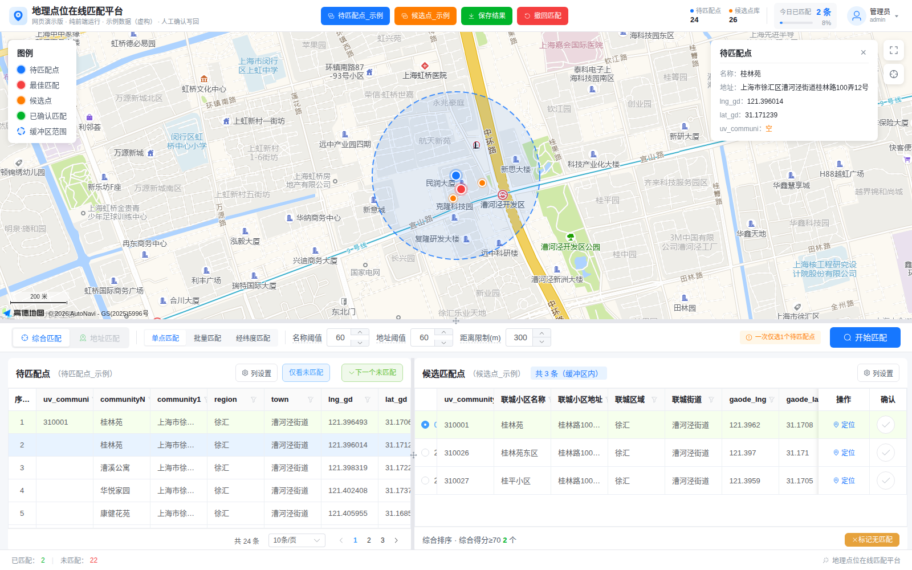
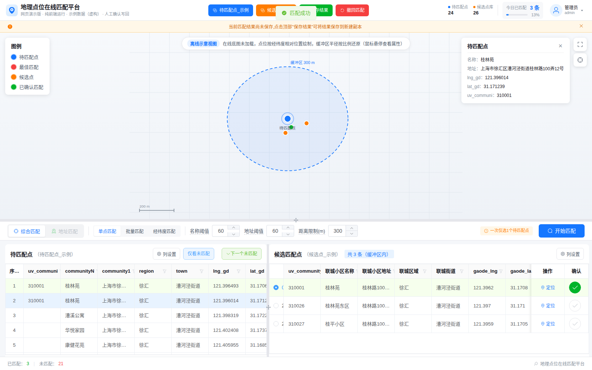

# 地理点位在线匹配平台（Geo Match Web）

> 面向多源 POI 数据校正的半自动匹配工具：机器预匹配 + 人工复核，把两个数据源的小区点位快速对应起来。
> 实习作品项目 · 独立完成技术选型、匹配算法与前后端实现。



## 背景

两个数据源（自有库 / 联城库）各有一套上海小区点位，需要把两边的同一个小区对应起来，才能同步房源的租金、图片等属性。
传统做法是把两份点数据同时加载进 ArcGIS，叠在底图上，一屏一屏肉眼比对：打开属性表定位第一个点 → 在地图上找另一个数据源里对应的点 → 判断是不是同一个小区 → 回表格填 ID。
上万条点位这么对，一个人一天最多几百条，且高度依赖主观判断，容易出错。

这个工具把这件事拆成两段：

1. **机器先跑一遍**：地址解析 + 缓冲区过滤 + 名称/地址模糊匹配 + 门牌号冲突检测，自动填掉置信度高的部分；
2. **人工只处理剩下的**：没匹配上的点在一个网页里逐个复核，地图上能看到候选点、距离、得分，点一下确认就写回结果。

## 功能

- **双源导入**：两个 CSV 分别作为「待匹配数据」和「候选点数据」，自动识别坐标列、名称列、地址列
- **地图辅助判别**：高德底图叠加待匹配点（蓝）、最佳匹配（红）、候选点（橙）、已确认（绿）与缓冲区虚线圆，点开可看全部属性
- **综合匹配**：缓冲区半径（默认 300 m）、名称阈值、地址阈值、候选数量均可现场调节
- **批量匹配**：一次跑完整表，结果弹出复核列表，可逐条勾选采纳
- **一键确认 / 撤回**：确认即写入 `uv_communi`，写错了可按 ID 撤回
- **版本化保存**：导出结果 CSV，原始文件不动
- **无坐标兜底**：两份数据都没有经纬度时，自动切到「仅文本地址匹配」模式



## 匹配算法

单点匹配的完整链路（`src/utils/smartMatch.js`）：

1. **地址结构化解析**
   用上海 16 区、200+ 街道乡镇字典把地址拆成 `区 / 街道 / 详细地址`，再把详细地址拆成 `道路 / 弄 / 号 / 号后缀（甲乙丙）/ 室`；支持「浦东」→「浦东新区」简称映射、门牌区间展开（如 `1-9号`）。

2. **候选预筛（两级）**
   先按「区 + 街道」缩小范围，再按 Haversine 距离做缓冲区过滤（默认 300 m），把逐条全表比较降到几十条。

3. **打分**
   - 名称得分：fuzz 相似度，并用 LCS 有序度惩罚“字都在但顺序乱了”的情况
   - 地址得分：道路名相似度 × 0.6 + 元素加分（弄相同 +15、号相同 +20、号后缀相同 +3、室号相同 +5）

4. **冲突检测（关键，直接决定准确率）**
   - 硬冲突：一方只有「弄」另一方只有「号」、号集合无交集、弄集合无交集、同号不同后缀、同道路但门牌数字无交集 → 直接判为不同小区，剔除候选
   - 软冲突：弄号错位但可能有交集 → 得分打 4 折后保留，交由人工判断

5. **排序与标记**
   按「有无冲突 → 综合得分 → 距离」排序，保留前 3 个备选写入结果，多候选的行在 Excel 里标红，方便人工优先复核。

6. **历史结果重校验**
   对上一轮已匹配的记录不跳过，重新跑一遍冲突检测，把历史错配清空。

## 技术栈

| 层 | 选型 |
| --- | --- |
| 前端 | Vue 3 + Vite + Pinia + Element Plus |
| 地图 | 高德地图 JS API 2.0（Marker / Circle / InfoWindow） |
| 后端 | Node.js + Express + MongoDB（集合管理、结果保存副本） |
| 数据处理 | PapaParse、fast-csv、@turf/turf |
| 算法 | 纯前端实现（编辑距离 + LCS + Haversine + 规则冲突检测） |

## 在线演示

https://yueyue3010.github.io/geo-match-web/

演示版为**纯前端静态站点**，不依赖后端与数据库：

- 打开即自动载入内置示例数据（24 个待匹配点、26 个候选点）
- 示例数据为**虚构数据**，不含任何真实业务数据
- 高德底图加载失败时会自动切换到离线经纬度示意视图，不会白屏

## 本地运行

```bash
# 前端
npm install
npm run dev

# 构建静态产物到 dist/
npm run build

# 构建到 docs/（GitHub Pages 使用这个目录发布）
npm run build:docs

# 可选：启动后端（需要本地 MongoDB），提供集合导入/保存能力
cd ../geo-match-backend && npm install && npm start
```

> `index.html` 中的高德 Key 为开发环境 Key，替换成自己的 Web 端 Key 并配置域名白名单后再部署。

## 部署到 GitHub Pages

仓库的 `docs/` 目录即构建产物，Pages 配置为：`Settings → Pages → Source: Deploy from a branch → main / docs`。
改完代码执行 `npm run build:docs` 再提交，站点自动更新。

## 目录结构

```
src/
├── components/          工具栏、地图、参数条、左右表格、各类弹窗
├── stores/matchStore.js 全局状态与匹配流程编排
├── utils/
│   ├── smartMatch.js    核心匹配算法（地址解析 / 打分 / 冲突检测）
│   ├── csvParser.js     CSV 解析、编码识别（UTF-8 / GBK）、坐标列检测
│   └── geoUtils.js      Haversine 距离、字符串相似度
└── demo/                演示版配置与示例数据自动加载
public/demo-data/        示例 CSV
../geo-match-backend/    Express + MongoDB 后端
```
